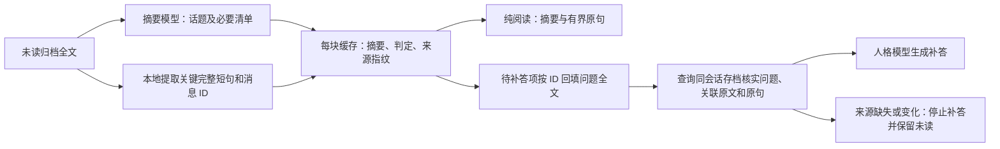

# 摘要保真：原句、消息 ID 与补答前核对

话题摘要用于导航，金额、日期、否定条件和作者归属尽量由原文提供。这样避免把“原文 → 摘要 → 问题复述 → 回复”连续改写几次。来源检查是本地数据库操作，不额外调用模型。

## 处理路径

`RollupChunk.summary` 仍是模型生成的概述，新增 `facts` 保存程序从原文摘出的关键短句；`context_text()` 合并两者。醒后准备上下文和手动爬楼返回该文本。

需要补答时，摘要模型只生成原消息 ID、是否冲 bot 来、已答／过期标记、关联 ID 和优先级。`who`、`what` 从同 ID 的原文回填，不采用模型对作者和问题的复述；因此 AtGuard／本地分流也拿到原问题。

## 原句选择与大小边界

`night/rollup_evidence.py` 识别包含数字、时间、否定、授权、审批、负责人、状态、更正或问题的完整短句。更正、否定条件和数字优先；超限时优先较新的信息，最终按原始顺序展示。相同作者的重复原句只保留一次。

| 限制 | 当前值 |
| --- | --- |
| 每块原句数量 | 最多 12 句 |
| 单句长度 | 最多 240 字符 |
| 每块原句合计 | 最多 1800 字符 |
| 原句来源字段 | 存档行 ID、消息 ID、会话、作者 ID／名称、时间戳 |

单句太长时整句不选，不截半句冒充完整事实。全文仍在首次阅读输入中，被选问题和关联消息在补答时按 ID 取全文。有限摘录不能保证覆盖每个事实，也不能保证模型正确理解所有条件。

实测发现宽泛匹配“只”会选中“那只猫”，所以缩窄为“只允许／只限／只能／只给”，并提高否定条件优先级。对应回归保证重复闲聊不会挤掉照片授权的否定原句。

## 补答前验证

`Rollup._llm_compose()` 在调用人格模型前完成以下检查：

1. 所有待答问题来自同一个会话，并与当前消息来源中的群／私聊会话一致。
2. 每条关键原句按存档行 ID、会话与消息 ID 查询；作者、时间戳及摘录必须与原文一致。
3. 每个问题按消息 ID 和已锁定的存档行查询，正文不得为空，来源指纹不得变化，群／私聊类型须匹配。
4. 关联消息必须在同会话、已读批次的上界内唯一存在，取完整正文。所有分块的事实一起传入，可核对后块对前块问题的更正。
5. QQ 提及仍由核实后的真实作者 ID 生成占位符。

问题来源指纹覆盖存档行、会话、消息 ID、作者和正文。原句另核对时间戳。无法核实时停止正文生成；醒后入口使用 `strict=True`，向上抛错并保留整批未读供重试，不把未核实摘要拼成回复。

提示明确要求按 ID 核对、采用后续明确更正、区分不同作者，并禁止认领用户的经历／照片／授权或编造更正历史。模型仍可能漏答或误读，所以“来源真实”与“答案正确”分别测试。

## 缓存和成本

缓存／提示版本均升至 3，旧缓存重新阅读。缓存不保存问题全文，命中后从原文回填；保存的有界摘录必须等于本批重新提取的结果，不能靠重算缓存校验和伪造原句。

纯阅读只生成约 100 字话题概述，输出请求上限 512 Token；需要清单时上限 2000 Token。原句由本地程序提取，不占摘要模型输出，但作为后续上下文会占输入 Token。

首次补答增加原文证据，可能稍贵；缓存复用减少重复摘要调用。实测中修订版纯阅读比旧生产流程少用约 38.4% 总 Token，但比第一阶段全部主场景的总 Token 多约 2.9%。不能宣称每类调用都会变便宜。

人格补答入口虽然传入 `max_tokens=600`，当前 `ModelHub.character_chat()` 没将其转交上游；`temperature` 也未实际传入。本轮按真实请求用量计费，不把这些形参当成已生效限制。更改该参数传递需要单独重测，尤其思考模型的输出上限包括思考 Token。

## 验证和维护

`tests/test_rollup_evidence.py` 的 10 项回归覆盖模型复述替换、完整长消息、源删除／变更、伪造摘录、异会话、跨块更正、缺源禁止降级、失败保留未读、缓存伪造和无关键词关联全文。GitHub 1.1.1 适配版与缓存、未读、醒后人格等相关的 114 项测试通过，包含缓存清除和备份恢复。

2026-11-03 合成实测使用当前模型和人格，保存 96 次实际请求账单、四份版本源码、固定数据、生成结果及逐事实人工评分。最终修订版主场景 39/39 参考事实保留、7/7 必要补答正确；否定和日期重复试跑也通过。合成小样本并非线上零失真保证。

完整结果在工作区 `文档/插件/Congling/congling-摘要保真与成本评估报告-20261103.md`。以后变更摘要提示、原句规则、模型或人格时，复用已保存数据集和评分口径；发现实际线上错例后新增脱敏回归，再判断是否改善。

本次线上已部署并用实际文件通过 112 项隔离测试；运行服务和插件加载正常。GitHub 1.1.1 兼容差异及复现命令见 [同步说明](摘要保真同步说明.md)。
